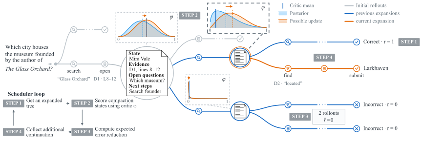

# FOCUS: Active Critic Learning for Long-Horizon Language Model Agents

[Paper](https://arxiv.org/abs/2610.35801) · [Documentation](https://zipJiang.github.io/FOCUS/)

## Abstract

Sparse outcome rewards make it difficult for long-horizon language-model agents to assign credit to earlier actions. Learned critics provide value estimates for intermediate states, but these estimates can be inaccurate, while estimating intermediate values with repetitive continuation samples from points within a trajectory incurs substantial costs. To mitigate these issues, we introduce FOCUS, an RL method that uses selective branching to help the critic network learn its value estimator. The rollout controller facilitates active learning for the critic by sampling continuations from states that are expected to most reduce the critic's estimation error. These refined value estimates then score the segment between consecutive states with a TD($\lambda$) advantage, while the sampled evidence supplies training targets for the critic. FOCUS supports long-horizon agentic reinforcement learning through a modular context-management interface that decouples context management from rollout allocation. Our experiments show that using compaction-induced segment boundaries for value estimation and credit assignment, FOCUS outperforms GRPO and VinePPO with matched per-step generation budgets on legal reasoning, deep search, and code localization benchmarks, improving held-out accuracy at Qwen3.5-9B scale by 7.2 points over the strongest baseline on BrowseComp-Plus (55.4 vs. 48.2) and by 4.1 points on DeonticBench (56.5 vs. 52.4).

## Pipeline



## Citation

```bibtex
@misc{jiang2026focus,
  title = {{FOCUS}: Active Critic Learning for
           Long-Horizon Language Model Agents},
  author = {Jiang, Zhengping and Jurayj, William and Wang, Liaoyaqi and
            Zuo, Chunsheng and Liu, Anqi and Van Durme, Benjamin},
  year = {2026},
  eprint = {2610.35801},
  archivePrefix = {arXiv},
  primaryClass = {cs.LG},
  url = {https://arxiv.org/abs/2610.35801}
}
```
