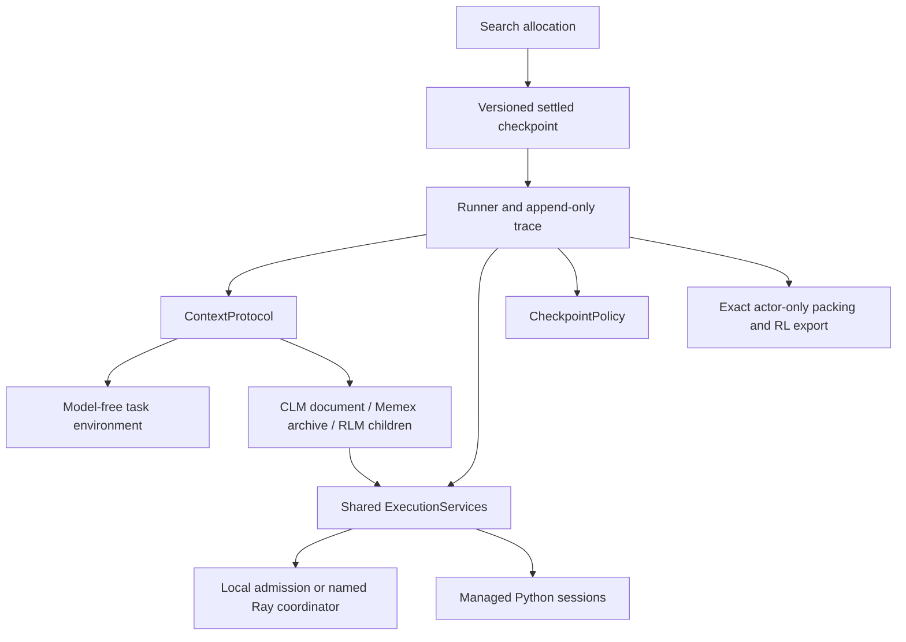

# 00 — Architecture and implementation map

FOCUS now separates which continuation to explore from how an invocation constructs
context and executes work. The scheduler operates on settled checkpoints. The harness
records exact generations and applies a ContextProtocol. ExecutionServices admits model
and process work through shared capacity. This keeps protocol customization out of
scheduler internals.

A context edit changes the next prompt. A checkpoint is a settled state that can be
restored. A training boundary separates incompatible conditioning or ownership. These
are independent, even when a summary operation happens to trigger all three.

The answer to the parallelism question is concrete: FOCUS's RLM batched-call APIs run
independent children concurrently, with ordered results. Recursion itself does not
require parallel execution. The shared executor controls capacity, and a parent waiting
for children owns no inference permit. One actor may generate parent, child and memory
decisions; optional fixed helpers remain observations and costs, excluded from actor loss.

## Read the implementation milestones

| Note | Commit | Main source / evidence |
| --- | --- | --- |
| [[01 — Behavioral baseline]] | `ddf12af` | harness characterization and migration checklist |
| [[02 — Checkpoints, context and generation identity]] | `f214b5d` | `focus/harness/{checkpoint,rollout,turn,packing}.py` |
| [[03 — Shared local inference and managed Python execution]] | `3e6055f` | `focus/execution/{pool,inference,process,worker}.py` |
| [[04 — One inference service across Ray workers]] | `463166e` | `focus/execution/ray.py`, real worker tests |
| [[05 — Context behavior is an extension point]] | `b9edd04` | `focus/protocols/base.py`, custom protocol example |
| [[06 — Editable CLM context]] | `f82e879` | `focus/protocols/clm.py`, prompt-edit tests |
| [[07 — Indexed experience memory]] | `dc6b17c` | `focus/protocols/memex.py`, exact retrieval tests |
| [[08 — Recursive and parallel invocations]] | `b25e086` | `focus/protocols/rlm.py`, nesting/overlap tests |
| [[09 — Actor training across context and recursive decisions]] | `db6b3bc` | packing, preparation, rescoring and Slime export tests |
| [[10 — Review findings and corrections]] | `2ea6c7d` | restoration/lifecycle regressions and Ray value scoring |
| [[11 — Delivery validation and extension exercises]] | See note commit | final matrix, runnable examples and packaging |

Read the [migration guide](../MIGRATION.md) before continuing old checkpoints.
Run `python -m examples.protocols --protocol rlm-memex` to inspect generations, actor
tokens, compute usage and remaining resources without a model service. The complete
local suite includes baseline coverage for BrowserComp-Plus, Deontic and LocBench.

## Paper concepts versus FOCUS choices

The RLM paper describes an invocation interface that “accepts a string prompt of
arbitrary structure and produces a string response.” Its page-2 discussion places the
input in a REPL variable for programmatic access and recursive calls.
@zhang2025recursive{#140a5398-6b5e-40aa-ad06-dd5e17aa4562}
FOCUS's batched APIs, admission fairness, budgets and snapshot restrictions are our
engineering choices, not claims that every RLM implementation has those properties.

CLM identifies that “Arbitrary context edits in CLMs pose new challenges for existing
serving systems”. @shao2026context{#d894eee8-0a00-4afe-bcc1-613cd2356020}
FOCUS uses a validated JSON message file and ordinary backend inference. It does not
implement the paper's Suffix Cache Reuse or reproduce its benchmarks.

Memex states: “keep the active reasoning state small, but do not throw evidence away.”
@wang2026memex{#188532aa-b452-420c-ab5b-93ce2e5e8c48}
FOCUS implements indexed original-history references and configurable memory shaping;
it exports context decisions through existing GRPO/TD/VinePPO interfaces. This is not a
claim to reproduce the complete MemexRL training procedure.

These citations were created from saved PDF text and read back in Ironquill. Whole
papers: [RLM](https://arxiv.org/abs/2512.24601),
[CLM](https://arxiv.org/abs/2609.37725),
[Memex](https://arxiv.org/abs/2603.04257).

## Limits and next experiments

Supported snapshots cover serializable data, imported modules, simple functions and
workspace files. Live handles, closures and cell-defined classes/instances are refused.
Execution is for trusted research code, not container isolation. One trainable actor
family, local or Ray services, and settled checkpoints are supported. Paper-scale
reproduction and distributed training of multiple actor families remain future work.

Exercises: implement a registered retention policy; compare sparse and every-decision
checkpoints; vary memory reward weights without regenerating a trace; compare a
capacity-one recursive run with a capacity-two batch; verify that a helper-only
likelihood change leaves actor importance ratios unchanged.
